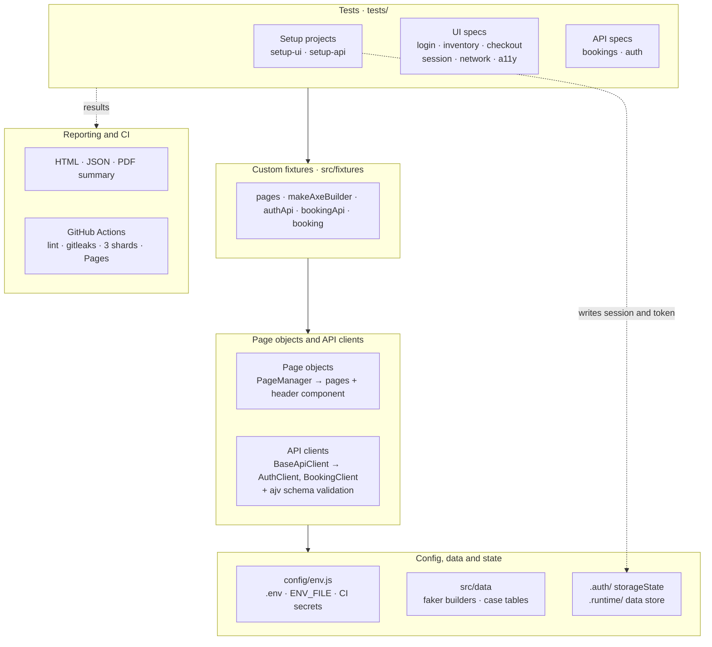
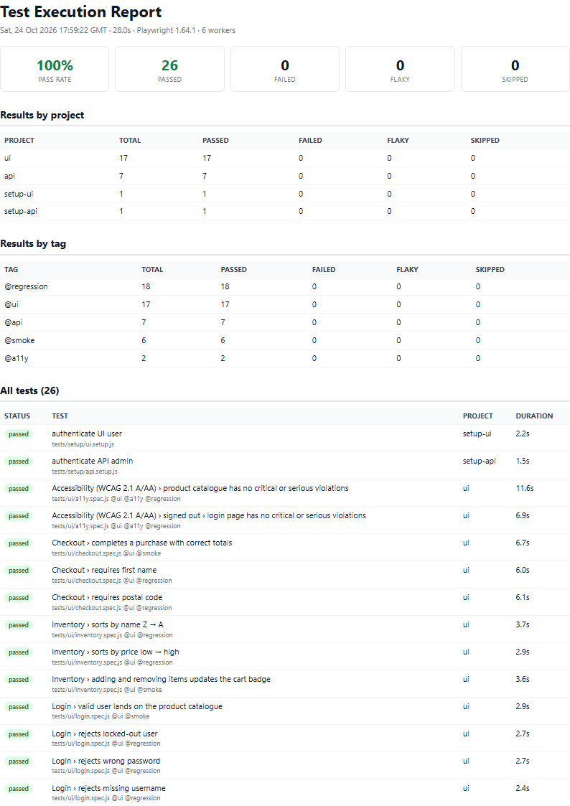

# Playwright E2E Framework

[](https://github.com/extension265/playwright-e2e-framework/actions/workflows/ci.yml)
[](https://playwright.dev)
[](LICENSE)

A production-style Playwright framework in JavaScript, covering UI, API, accessibility and network testing, with sharded CI and a published report.

It runs against two public demo apps: [Sauce Demo](https://www.saucedemo.com) (UI) and [Restful Booker](https://restful-booker.herokuapp.com) (API).

Patterns adapted from a framework I designed and built from scratch for a production web application, rebuilt here against public demo apps.

**📊 [Live test report](https://extension265.github.io/playwright-e2e-framework/)** · **📄 [PDF summary](https://extension265.github.io/playwright-e2e-framework/test-summary.pdf)** · Both are rebuilt on every push to `main`.

## Why this framework

- **Slow suites that log in for every test.** It authenticates once per run and reuses the session (browser `storageState` for UI, a token handoff for API). Tests start already signed in.
- **Brittle tests full of copy-pasted locators.** Page objects keep each locator in one place, and custom fixtures hand tests ready-made pages, API clients and data, so specs read like test cases.
- **API changes that slip through unnoticed.** Every API response is checked against a JSON schema inside the client, so a renamed or extra field fails the build before any assertion runs.
- **Reports nobody opens and pipelines nobody waits for.** CI runs in 3 parallel shards, merges them into one HTML report on GitHub Pages, and adds a short PDF summary for people who won't click through a test report.

## Tech stack

| Area          | Tools                                                                              |
| ------------- | ---------------------------------------------------------------------------------- |
| Test runner   | Playwright Test 1.64 (JavaScript, ES modules), Node 24                             |
| API           | Playwright `APIRequestContext`, ajv + ajv-formats (JSON Schema)                    |
| Accessibility | @axe-core/playwright (WCAG 2.1 A/AA)                                               |
| Test data     | @faker-js/faker builders, data-driven case tables                                  |
| Reporting     | Playwright HTML + JSON, custom PDF summary (rendered by Playwright's Chromium)     |
| CI/CD         | GitHub Actions: 3 shards, blob-report merge, GitHub Pages, npm and browser caching |
| Quality gates | ESLint 10 + eslint-plugin-playwright, Prettier, gitleaks secret scanning           |

## Architecture



Tests get their page objects and API clients from fixtures rather than constructing them, and import test data from `src/data`. All configuration comes from a single module. The setup projects write the saved session and API token once per run, and every test reads them.

## Folder structure

<details>
<summary>Show folder structure (12 folders)</summary>

| Path            | Purpose                                                                                   |
| --------------- | ----------------------------------------------------------------------------------------- |
| `tests/setup/`  | Setup projects: log in through the UI and save `storageState`; fetch the API token        |
| `tests/ui/`     | UI specs: login, inventory, checkout, session reuse, network mocking, accessibility       |
| `tests/api/`    | API specs: booking CRUD and auth                                                          |
| `src/pages/`    | Page objects, the `PageManager` entry point, and `components/` for UI shared across pages |
| `src/api/`      | API clients built on `BaseApiClient`; `schemas/` holds the JSON Schemas and validator     |
| `src/fixtures/` | Custom fixtures, the only import specs need (`test`, `expect`)                            |
| `src/data/`     | Test data: faker builders and data-driven case tables                                     |
| `src/utils/`    | `dataStore`: hands values from setup projects to tests                                    |
| `config/`       | `env.js`, the only module that reads environment variables                                |
| `scripts/`      | PDF report generator and the `test:report` runner                                         |
| `docs/`         | Sample PDF report and preview image                                                       |
| `.github/`      | CI workflow and a shared setup action (Node, npm cache, cached Chromium)                  |

</details>

## Key design decisions

**Page Object Model.**

- Each screen is a class whose locators are declared in its constructor.
- Page objects perform actions but never assert; tests decide what correct looks like.
- `PageManager` creates pages on first use, so a test only builds what it touches.
- The header shared by every signed-in page is a component, not something copied into each page.
- Locators use the app's `data-test` attributes (set via `testIdAttribute`) and ARIA roles, never CSS classes.

**Custom fixtures.**

- Tests declare what they need (`pages`, `bookingApi`, `booking`) and receive it ready to use, with setup and teardown kept out of the test body.
- The API request context is worker-scoped: one per worker, shared by that worker's tests.
- The `booking` fixture creates a fresh booking for each test and deletes it afterwards.

**Auth reuse.**

- The `setup-ui` project logs in once and saves cookies and localStorage. The `ui` project loads that file, so its tests start signed in.
- Specs that must start signed out (login, signed-out network, login-page a11y) opt out with `test.use({ storageState: { cookies: [], origins: [] } })`.
- `setup-api` fetches one admin token per run.
- Project dependencies run setup automatically, including when you run a single test.

**Test data.**

- Builders produce unique, realistic data on every call (faker), and tests override only the fields they care about.
- Data-driven tests loop over case tables in `src/data/`.
- Negative login cases are derived from the valid credentials, so no secret is ever duplicated in test data.

**Every test is independent.**

- The `dataStore` is strictly a one-way handoff: setup projects write, tests only read. Today it holds one value, the API token.
- No test depends on another test's leftovers. Each creates what it needs through fixtures, so tests can run alone, in any order, on any shard.
- Verified by running single tests from a clean state (no saved session or token) and the full suite 3× (`--repeat-each=3`) with zero flakes.

**API contract checks.**

- `BaseApiClient` returns `{ status, body, response }`, so error paths are as easy to assert as success.
- Successful responses are validated against JSON Schemas with `additionalProperties: false`.

**Restful Booker quirks.** Tests assert what the API actually does, not what REST conventions would suggest.

<details>
<summary>Show the 4 quirks and how the tests handle them</summary>

| Call                                | Returns                                | Why it matters                                                        |
| ----------------------------------- | -------------------------------------- | --------------------------------------------------------------------- |
| `POST /auth` with bad password      | `200` + `{"reason":"Bad credentials"}` | A status-only check would pass; the test asserts the body too         |
| `DELETE /booking/:id`               | `201 Created` (text)                   | Asserted as-is; a follow-up `GET` confirms `404 Not Found`            |
| `PUT` without a token               | `403 Forbidden` (text, not JSON)       | The client parses JSON only when the content type says so             |
| Deleting an already-deleted booking | `405 Method Not Allowed`               | The `booking` fixture's cleanup tolerates tests that deleted it first |

</details>

**Parallelisation and sharding.**

- `fullyParallel: true` locally (6 workers on a typical laptop, about 30s for the full suite).
- CI runs 3 shards. Each uploads a blob report, and a final job merges them into one HTML report, the JSON results and the PDF.
- Setup projects run in every shard that needs them, so the merged report lists them once per shard.

**Retries and flakiness.**

- UI tests get **0 retries**: a flaky UI test is a bug to fix, not to hide.
- Only the `api` and `setup-api` projects retry (2× in CI). The public API runs on a shared free-tier server whose cold starts and periodic data resets cause failures that aren't product bugs.
- Lint enforces no fixed waits (`waitForTimeout`) and auto-waiting assertions.
- Traces, videos and screenshots are kept for failures only.
- The PDF lists flaky tests separately, so they're visible even when the build passes.

**Accessibility gate.**

- axe scans against WCAG 2.1 A/AA and fails only on `critical` or `serious` violations.
- The full results are attached to each test in the report, so lesser findings can still be triaged.

**Network tests.**

- `page.route` makes every product image return 503, and the test checks that the catalogue stays usable.
- `waitForResponse` captures the image request triggered by logging in, then checks the rendered `` is that exact resource.

**Secrets.**

- `config/env.js` is the single reader of environment variables and stops the run with a clear message when one is missing.
- `.env.example` contains the **public** demo credentials only so the repo runs straight after cloning. In a real project that file holds placeholders, real values live in CI secrets or a vault, and `.env` is never committed (it's gitignored here too).
- CI reads credentials from repository secrets.
- gitleaks scans the full history with a custom rule for plain-text passwords, which its default rules miss.

## Quick start

Requires Node 22+ (`.nvmrc` pins 24).

```bash
git clone https://github.com/extension265/playwright-e2e-framework.git
cd playwright-e2e-framework
npm ci
npx playwright install --with-deps chromium
cp .env.example .env            # Windows (cmd): copy .env.example .env
npm test
npm run report                  # opens the HTML report
```

<details>
<summary>Show all npm scripts</summary>

| Command                        | What it does                                                |
| ------------------------------ | ----------------------------------------------------------- |
| `npm test`                     | Full suite (setup, UI and API projects)                     |
| `npm run test:smoke`           | `@smoke` tests only                                         |
| `npm run test:regression`      | `@regression` tests only                                    |
| `npm run test:a11y`            | `@a11y` tests only                                          |
| `npm run test:ui` / `test:api` | One project, plus its setup dependency                      |
| `npm run test:report`          | Run the suite, then always build `reports/test-summary.pdf` |
| `npm run report:pdf`           | Build the PDF from the last run                             |
| `npm run lint` / `format`      | ESLint / Prettier                                           |

</details>

> Passing `--reporter=…` on the command line replaces the configured reporters, so the JSON (and the PDF built from it) won't update. Use the npm scripts above.

**Running CI on a fork:** add repository secrets `UI_USERNAME`, `UI_PASSWORD`, `API_USERNAME` and `API_PASSWORD` (the values are in `.env.example`), then set **Settings → Pages → Source** to **GitHub Actions**.

## What the code looks like

A fixture that gives each test its own booking and cleans up afterwards (`src/fixtures/index.js`):

```js
booking: async ({ bookingApi }, use) => {
  const { status, body } = await bookingApi.create(buildBooking());
  expect(status, 'fixture: create booking').toBe(200);
  await use({ id: body.bookingid, data: body.booking });
  // Teardown: tolerate tests that already deleted it (API answers 405 then).
  await bookingApi.delete(body.bookingid);
},
```

A UI test: tagged, already signed in through the saved session, and data-driven where it pays off (excerpt from `tests/ui/checkout.spec.js`):

```js
test('completes a purchase with correct totals', { tag: '@smoke' }, async ({ pages }) => {
  const { checkout } = pages;
  await checkout.submitCustomerInfo(buildCustomer());

  const { itemTotal, tax, total } = await checkout.summary();
  expect(toCents(tax)).toBe(toCents(itemTotal * TAX_RATE));
  expect(toCents(total)).toBe(toCents(itemTotal) + toCents(tax));

  await checkout.finish();
  await expect(checkout.completeHeader).toHaveText('Thank you for your order!');
});

for (const { missing, overrides, error } of checkoutValidationCases) {
  test(`requires ${missing}`, { tag: '@regression' }, async ({ page, pages }) => {
    await pages.checkout.submitCustomerInfo(buildCustomer(overrides));
    await expect(pages.checkout.error).toHaveText(error);
    await expect(page).toHaveURL(/checkout-step-one/);
  });
}
```

## Reports

- **HTML:** the [live report](https://extension265.github.io/playwright-e2e-framework/) has traces, videos and screenshots for failures, plus the axe results for each accessibility test.
- **PDF:** a short summary with pass rate, results by project and by tag, failures with their error text, and the full test list. Paths are shown relative to the repo, and usernames and local folders are stripped. See the [sample](docs/sample-test-summary.pdf).



## What I'd add next

- **Cross-browser:** Firefox and WebKit projects on a nightly schedule, keeping pull requests fast on Chromium.
- **Visual regression:** `toHaveScreenshot` run inside the official Playwright Docker image, so screenshots render the same everywhere.
- **Contract tests from a spec:** generate the JSON Schemas from an OpenAPI document instead of maintaining them by hand.
- **Trend history:** keep each run's results to track flakiness and duration over time.
- **TypeScript:** type the page objects and fixtures for editor autocompletion and refactoring safety.

## Author

**Saikat Ganguly** · [LinkedIn](https://www.linkedin.com/in/saikat-ganguly-238a54175/)

## License

[MIT](LICENSE) © Saikat Ganguly
